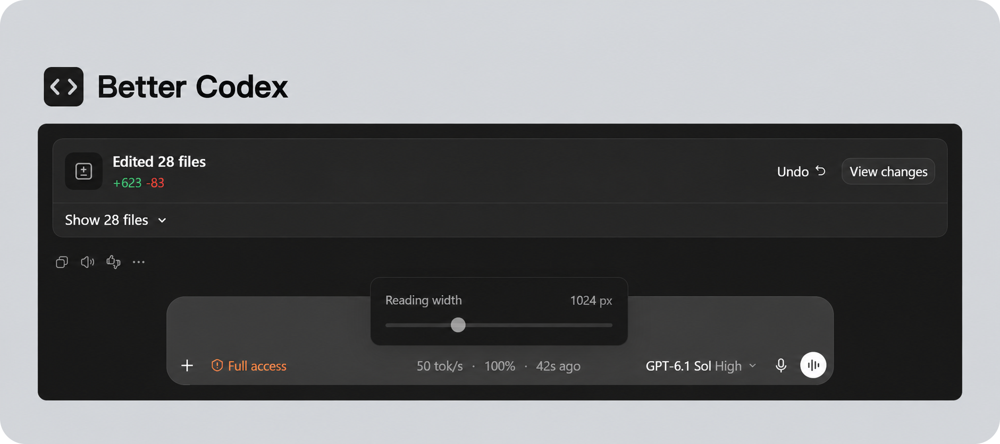

<h1 align="center">Better Codex</h1>

<p align="center">
  <a href="https://github.com/MaxMiksa/better-codex/releases/tag/v0.3.1"></a>
  <a href="#"></a>
  <a href="LICENSE"></a>
  &nbsp;&nbsp;
  <a href="README.md"></a>
</p>

✅ **不用安装 Python/Node.js · 中英文支持 · 本地处理**  
✅ **内嵌统计 · 正文宽度调节 · 文件变更列表收起**  
✅ **Windows 11 · 官方 Codex 桌面应用**  

让 Codex 更好用的小功能合集。它把实用统计放在输入框旁，并让你按自己的习惯调整阅读空间。本项目由社区独立开发，与 OpenAI 没有隶属关系。

## 🎬 演示

<p align="center"></p>

*内嵌统计、正文宽度调节与文件变更列表收起。*

## ✨ 功能

| 功能 | 使用体验 |
| --- | --- |
| 内嵌统计 | 用灰色文字在输入框旁显示最近一次响应的输出速度、输入缓存比例和统计时间。 |
| 正文宽度 | 点击统计文字调整正文宽度，最大 1600px。自动保存偏好，输入框保持原宽度。 |
| 文件列表收起 | 多文件变更列表默认收起，需要时展开全部；保留查看变更和撤销入口。 |
| 中英文支持 | 界面标签、安装与启动提示自动选择英文或简体中文。 |
| 联合启动 | 用快捷方式一起打开 Codex 和增强功能，登录启动可以单独开启。 |
| 随时停止 | 恢复原生布局，Codex 继续运行。 |

速度是根据本地用量和计时记录计算的**最近一次已完成响应均速**，不是逐 token 实时速度；缺失数据不会记成零。

## 🚀 开始使用

需要 **Windows 11 x64 和官方 Codex 商店应用**。便携包已包含独立的 Python、Node.js 和依赖，不用安装系统运行环境，首次启动也不下载依赖。

1. 从 [Releases](https://github.com/MaxMiksa/better-codex/releases/tag/v0.3.1) 下载 **`better-codex-v0.3.1-windows-x64-portable.zip`**。
2. 将 ZIP **完整解压**到可写且准备长期保留的目录。
3. 双击 **`BetterCodex.exe`**。点击输入框底部的统计文字调节正文宽度；双击 `Stop.cmd` 可停止增强功能。

如果已经打开的 Codex 没有启用本地显示接口，请先保存工作，**方便时正常退出 Codex**，再从新快捷方式启动。工具不会强制重启应用。

## 📚 更多

<details>
<summary><b>📋 环境要求与限制</b></summary>

当前版本在 Windows 11 x64、Codex 桌面包 `26.1013.4894.0` 上验证。其他版本、多窗口和全部显示缩放比例尚未充分验证；Codex 更新后可能需要适配。启动程序尚未签名，Windows 可能显示发布者提示。

统计依赖可读取的本地 Codex 会话记录，不测量只有云端记录的聊天。Chat 模式可以沿用正文宽度，但不显示 Codex 统计。

安装和启动提示默认跟随 Windows 显示语言；进入 Codex 后，HUD 标签、相对时间、正文宽度控件和文件列表按钮跟随 Codex 的实际界面语言，切换语言时同步更新。Codex 未声明语言时，才使用启动时选定的电脑语言。支持英文和简体中文，其他语言回退英文；Codex 原生按钮和第三方安装工具沿用各自语言。

当前版本没有模型能力或降级检测、插件市场或自动更新功能，不承诺加快模型生成。请保持本地显示接口仅供本机访问，不要暴露或转发到外网。

</details>

<details>
<summary><b>🧭 快捷方式、登录启动与卸载</b></summary>

固定到任务栏时，使用 `launchers/Codex.lnk`。若已固定原 Codex 图标，请先取消固定，再固定联合入口。其他程序或其他安装目录的快捷方式不会被覆盖。升级或移动目录前先停止旧副本；若启用了登录启动，切换目录前先取消旧入口，之后按需启用新入口。再双击新位置的 BetterCodex.exe；整体移动时会重建本机路径并保留宽度偏好。Windows 可能缓存旧任务栏路径，必要时重新固定新快捷方式。

首次安装默认不开启登录启动。需要时执行：

```powershell
.\tools\token-hud-local\Set-LoginStartup.ps1 -Mode Enable
```

启用后，请在 Codex 自身设置中关闭官方登录启动，保持单一入口。取消本项目登录启动时使用 `-Mode Disable`。卸载时先取消已启用的登录启动，再运行 `Stop.cmd`、取消固定该快捷方式，最后删除解压目录；Codex 本身和聊天历史保留。

</details>

<details>
<summary><b>🔎 与三个相近项目对比</b></summary>

| 项目 | 主要侧重 | 适合的需求 |
| --- | --- | --- |
| **Better Codex** | Windows 应用内统计，以及正文宽度和文件列表优化 | 希望在聊天界面内获得一组简洁增强功能 |
| [codex-token-hud](https://github.com/drkang7/codex-token-hud) | 本地速度与缓存统计、悬浮窗口、历史及区间统计 | 需要更丰富的独立统计工具；本项目采集器来自该项目 |
| [codex-lite-hud](https://github.com/flitfancy/codex-lite-hud) | Windows 原生轻量悬浮条，提供用量、上下文、用时和额度 | 希望使用不携带 Node.js/Python 的小型原生 .NET HUD |
| [codex-speed-hud](https://github.com/Creative-developer-single/codex-speed-hud) | 应用内流式估速、延迟和费用显示 | 需要实时输出估算；文档目前记录的桌面验收平台为 Linux |

依据各项目自身文档，于 2026-10-18 核对。不同项目的速度口径不同，不宜把读数当作同一性能基准；此表比较功能定位，不代表完整测试了它们的所有发行版。

</details>

<details>
<summary><b>🔐 本地数据与隐私</b></summary>

模型请求继续使用 Codex 既有连接。本工具读取本地用量记录并调整本机界面，不增加模型转发代理，也不需要额外 API 密钥。便携版启动时不下载依赖。Codex 模型请求仍需要原有网络连接，离线打包不代表模型可以离线运行；只有可选的源码安装流程访问 Python/npm 软件包源。

本地运行文件可能包含聊天标识、标题、文件路径和用量信息。反馈问题时不要上传 `.runtime/` 或原始 Codex 日志。详见[隐私说明](docs/PRIVACY.md)。

</details>

<details>
<summary><b>🛠️ 故障排查与已知限制</b></summary>

统计未出现时，可运行 `tools/token-hud-local/Start-ComposerHud.ps1 -CheckOnly`。`restart-required` 表示需要用户方便时正常退出应用，再从联合入口启动；`hud-preparation-failed` 通常是文件缺失或损坏，可先停止本 HUD，再将完整便携 ZIP 解压到新目录。不要直接在压缩包中运行。只有源码安装才需要 Install.ps1 的 Python/Node 参数。

破折号表示缺少用量或计时，不是速度为零。新轮次、聊天关联不确定、数据过期或页面结构不兼容时，统计可能隐藏，避免显示其他聊天的旧数据。随时可以运行 `Stop.cmd` 恢复原生界面。

</details>

<details>
<summary><b>💻 开发说明</b></summary>

同时保留 `better-codex-v0.3.1-source.zip`。源码安装需要 Python 3.11+ 和 Node.js 20+，在解压目录运行 `powershell -NoProfile -ExecutionPolicy Bypass -File .\Install.ps1`。可加 `-Language en` 或 `-Language zh-CN` 明确选择安装提示语言，默认自动选择。便携版已经包含运行环境，无需下载浏览器。[开发说明](docs/DEVELOPMENT.md)列出模块职责、隔离检查及打包方式。公开包不包含运行数据、私人探索记录或本机配置。

</details>

## 🙏 致谢

感谢 [codex-token-hud](https://github.com/drkang7/codex-token-hud) 提供本项目复用的本地采集器，也感谢 [codex-lite-hud](https://github.com/flitfancy/codex-lite-hud)、[codex-speed-hud](https://github.com/Creative-developer-single/codex-speed-hud) 和 [openai/codex](https://github.com/openai/codex) 的开源工作。代码复用范围、来源版本及许可证见[第三方声明](THIRD_PARTY_NOTICES.md)。

## 🤝 贡献与联系

欢迎提交 Issue 和 Pull Request！  
如有任何问题或建议，请联系 Zheyuan (Max) Kong (卡内基梅隆大学，宾夕法尼亚州)。

Zheyuan (Max) Kong: kongzheyuan@outlook.com | zheyuank@andrew.cmu.edu
