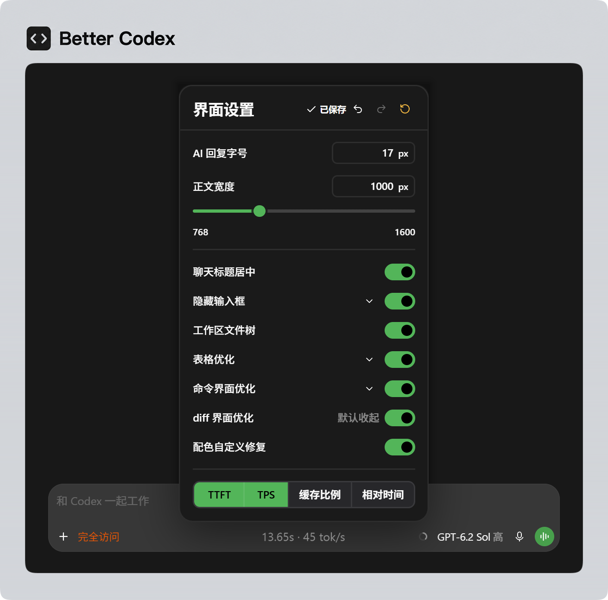
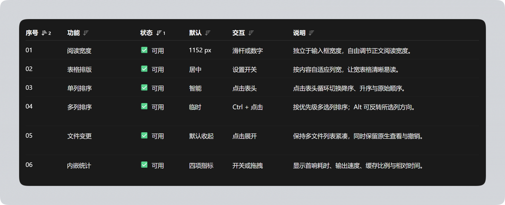
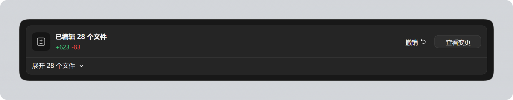
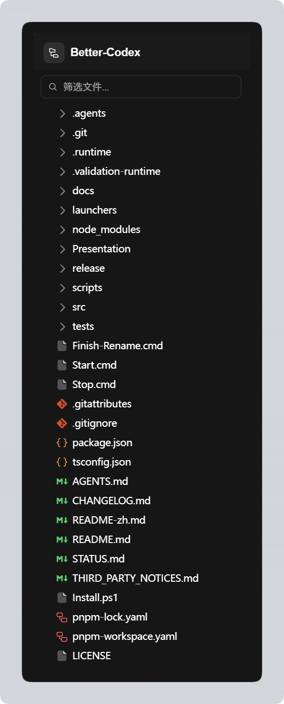
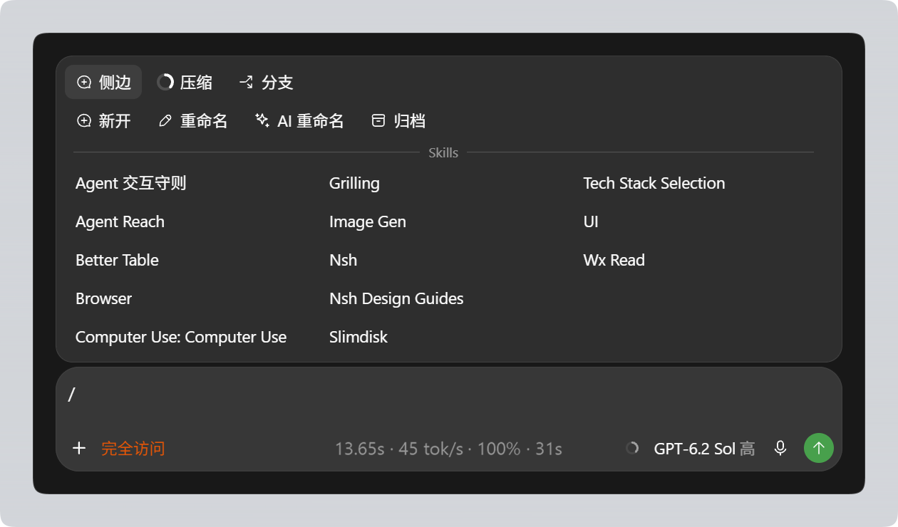
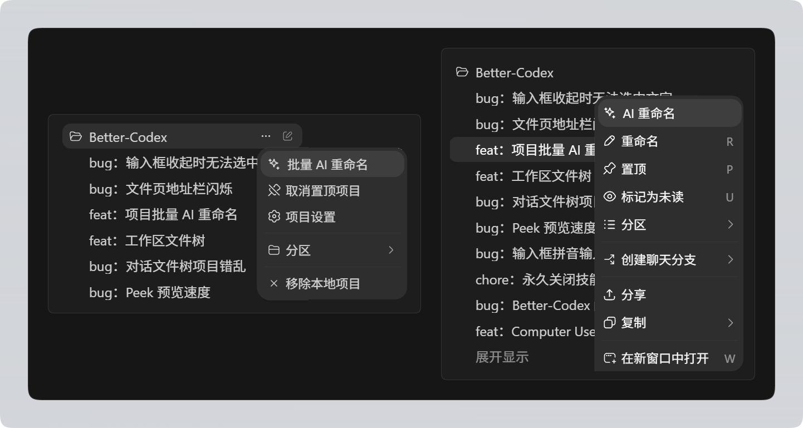

<h1 align="center">Better-Codex</h1>

  
  
  
  &nbsp;&nbsp;
  

面向 Windows 官方 Codex 桌面端的可插拔界面增强与启动守护层：提供统一界面设置、内嵌统计条、工作区文件树、增强斜杠命令菜单、AI 重命名、输入框自动隐藏、表格排序与多文件变更收起，所有增强均可随时完整撤回。社区独立项目，与 OpenAI 没有隶属关系。

**Windows 11 x64 · 官方 Codex 商店应用 · 英文 / 简体中文 · 单一内置 Node.js 24 运行环境（便携包约 37 MB）**

配图均以 Codex 真实截图为底（去除无关背景干扰）；统计数值与演示表格为示例数据。

## 核心功能

### 阅读、排版与表格

- **统一界面设置**：点击输入区底部的统计条即可打开「界面设置」。正文宽度可在 `768–1600 px` 间调节，「AI 回复字号」可独立设为 `10–40 px`（留空跟随原生），支持聊天标题居中与各项开关；修改自动保存，支持撤销、重做、恢复默认与多窗口实时同步。主聊天、侧边聊天与子代理各自受面板宽度约束，输入框保持原宽；原生文件页地址栏防抖不闪烁。
- **自动隐藏输入框**：在「界面设置」中选择关闭、最小化或完全隐藏。已有聊天的空输入框在失焦（任务运行中同样生效）或按 `Esc` 后收起，并保持底部文件变更胶囊可见。正文区直接打字即可展开，首个拼音字母即进入中文输入法；从侧栏点开聊天后也可连按两次 `Enter` 展开，或点击最小化时的「展开输入框」。拖选正文不抢焦点；开启「发送后自动隐藏」后发送成功即收起。空白新聊天、未发送草稿与附件始终保持显示。
- **表格排版与排序**：按内容自适应列宽，可独立于正文宽度居中显示。点击表头循环切换排序方向与原始顺序；按住 `Ctrl` 依次多列排序（先选优先），`Alt` 可预设或反转方向，设置内可选首次点击为智能、升序或降序。排序仅改变页面视觉顺序，复制仍保留原始 Markdown 顺序。
- **多文件变更默认收起**：多文件变更卡片默认收起为紧凑入口，完整保留原生「撤销」与「查看变更」操作，手动展开的卡片保持状态。

### 工作区文件树与斜杠菜单

- **工作区文件树**：在聊天左侧实时展示当前会话的工作区或 worktree，支持文件筛选、按类型分组排序、拖动调宽与按项目记忆展开状态，与原生右侧栏同开不裁切正文。点击顶部项目名打开目录，双击打开文件（脚本与可执行文件仅定位不直接执行），右键资源管理器定位，空格调用可选的独立预览器 [Preview](https://github.com/MaxMiksa/preview) 或 [QuickLook／PowerToys Peek](src/features/workspace-tree/README.md) 快速预览。
- **增强 `/` 斜杠命令菜单**：顶层命令改为紧凑横排分组，下方依次展示三列 **Skills** 与三列 **Prompt** 快捷模板（读取 Codex Home 一级 `prompts/` 目录 Markdown）。在「界面设置 → 命令界面」中可拖动排序、调整命令与 Skills 逐项显隐（默认隐藏 Health、Excel Live Control、Spreadsheets、Visualize、Create Statusline，不影响原生 `$` 选择器）。选中 Prompt 仅在当前光标处插入正文，不替换草稿、不自动发送；`Ctrl+↑/↓` 可在命令组、Skills 与 Prompt 间快速跳转。

### AI 重命名

- **单聊与项目批量 AI 重命名**：可在侧栏聊天菜单或 `/` 菜单为单条聊天智能命名，也可在侧栏项目 `…` 菜单选择「批量 AI 重命名」。批量模式由程序筛选该分组下未删除、未归档且标题不含 `：` 的本地与工作树聊天（最多 3 路并发，保存前二次核对），Luna 仅生成如 `feat：AI 重命名` 的结构化标题，由 Codex 在后台原生保存，不触碰草稿。

### 内嵌统计、配色与运行观测

- **四项内嵌统计**：输入区底栏显示本轮首次响应耗时（**TTFT**）、输出速度（**TPS**）、输入缓存比例与相对时间，每窗独立绑定各自的主聊天。可在设置中逐项显隐或拖动排序，窄栏自动避让按钮与额度圆环；语言跟随 Codex 的英文/简体中文界面。Chat 模式沿用正文宽度与字号、不显示统计；文档与空白页保持原生。
- **Custom 配色修复**：使用 Codex 自定义强调色时，自动计算高对比度黑白文字前景修正消息气泡与发送按钮可读性；原生预设配色保持不变。
- **本地运行历史**：通过 `src/platform/observability/Get-RuntimeHistory.ps1`（或 `pnpm run history`）查询最近 5 天的本地 SQLite 启动、增强与恢复记录；仅留本机，不记录聊天正文。

> **关于统计口径**：TTFT 取本轮首次模型响应。速度优先使用 magpie 提供的本轮最近有效原生值；确认连接不可用后，后续轮次改用本地已完成响应均速（从已知请求边界至用量记录，包含等待与推理、排除已知工具执行；输出用量含推理与工具调用 token）。缺少计时依据时保持为空、不补零，同一轮不混用速度来源。纯云端聊天无法提供本地统计，统计也不承诺加快生成。采集器异常退出时仅暂时缺失统计，其余全部增强保持可用。

## 开始使用

1. 从 [v1.0.0 Releases](https://github.com/MaxMiksa/better-codex/releases/tag/v1.0.0) 下载 `better-codex-v1.0.0-windows-x64-portable.zip`。
2. **完整解压**到可写、准备长期保留的目录。
3. 双击 `BetterCodex.exe`；点击输入框底部的统计条即可打开界面设置。便携包内置单一运行环境，无需另装 Node.js、Python 或 Playwright，首次启动不下载依赖。

Codex 未运行时，从快捷方式启动会自动运行最小化体检，仅在需要关注时展开完整窗口；全部通过后保持最小化（或自动收回任务栏），30 秒后自动关闭。若 Codex 已在运行，点击任务栏图标会直接唤起窗口，不再重复体检。确认增强未加载或刚完成 Codex 更新后，检测结束会启动 **15 秒重开倒计时**，点击立即执行或按 **X / Esc** 取消以保留手头工作。重开仅请求正常退出，绝不强制终止、失败不循环。

随时双击 `Stop.cmd` 即可停止增强、还原原生布局，不关闭 Codex 也不影响聊天历史；再次运行 `BetterCodex.exe`（或 `Start.cmd`）即可恢复。

## 常用设置

以下命令在已初始化的目录运行。新安装默认关闭登录启动与 Codex 更新监测，日常使用普通权限启动入口。

| 任务 | PowerShell 命令 |
| --- | --- |
| 启用登录启动 | `.\src\lifecycle\installation\Set-LoginStartup.ps1 -Mode Enable` |
| 启用 Codex 更新监测 | `.\src\lifecycle\recovery\Set-UpdateRecovery.ps1 -Mode Enable` |
| 查看开关状态 | 对应脚本使用 `-Mode Status` |
| 关闭上述开关 | 对应脚本使用 `-Mode Disable` |
| 只读启动检查 | `.\src\app\Start-ComposerHud.ps1 -CheckOnly` |
| 查看 5 天运行历史 | `.\src\platform\observability\Get-RuntimeHistory.ps1` |

请保持单一登录入口：启用本项目登录启动时关闭 Codex 自带的登录启动。更新监测需增强后台保持运行，确认 Codex 升级后会弹出同一体检与可取消的重开倒计时（不负责更新 Better-Codex 本体；未来真实 Codex 升级恢复仍待自然使用验收）。

固定任务栏请使用 `launchers/Codex.lnk`：先取消固定原 Codex 图标，再固定联合入口。

升级、移动与卸载

- **从 v0.5.x 升级到 v1.0.0**：详见 [v1.0.0 升级指南](docs/UPGRADE-v1.md)，首次运行会自动将既有偏好无损迁移至 `.runtime/settings.json` 并更新本副本快捷方式。
- **常规升级或移动目录**：先关闭已启用的登录启动并运行 `Stop.cmd`，完整解压新包或整体移动目录后运行新位置的 `BetterCodex.exe`（必要时重新固定 `launchers/Codex.lnk`）。其他安装副本的快捷方式不会被接管。*（若从旧版 v0.4.1 迁移且曾开启管理员启动，先在旧副本运行 `tools/token-hud-local/Set-AdministratorLaunch.ps1 -Mode Disable`。）*
- **卸载**：关闭登录启动、运行 `Stop.cmd`、取消固定任务栏图标并删除目录即可；Codex 与聊天历史完整保留。

## 问题与限制

| 现象 | 处理 |
| --- | --- |
| 统计未出现 | 先做只读检查；需完整体检时运行 `src/lifecycle/diagnostics/Show-StartupCheck.ps1`，工作中注意取消重开倒计时 |
| `restart-required` | 现有 Codex 实例缺少显示接口或不满足启动条件；方便时正常退出，再从联合入口打开 |
| `hud-preparation-failed` | 检查文件是否完整；停止增强后将完整 ZIP 解压到新目录，勿在压缩包内运行 |
| 显示 `-` 或暂时隐藏 | 缺少用量/计时、聊天关联不确定、数据过期或布局不兼容；不代表速度为零，也不借用其他聊天数据 |

体检不发送模型消息、不验证模型鉴权、不控制 VPN。Codex 页面更新可能需要适配；所有版本、窗口布局与缩放比例尚未逐一覆盖。便携启动程序尚未签名，Windows 首次运行可能提示发布者信息。

## 隐私

模型请求继续使用 Codex 原有连接，不增加模型转发代理、不需要额外 API 密钥（便携打包不代表模型可离线运行）。**AI 重命名**是本项目唯一会在你主动触发后将由聊天派生的文本发往模型的功能，详见[隐私说明](docs/PRIVACY.md)；体检仅沿检测到的网络路径发送不带凭据的轻量 HTTPS HEAD 探针。

`.runtime/` 下可能含聊天标识、标题、路径与用量。**请勿上传 `.runtime/`、认证文件或原始 Codex 日志**；反馈请提供版本、现象与体检脱敏报告，勿向外网暴露或转发本机显示端口。详见[隐私说明](docs/PRIVACY.md)。

## 开发与来源

如需固定版本源码，可从 [v1.0.0 Releases](https://github.com/MaxMiksa/better-codex/releases/tag/v1.0.0) 下载 `better-codex-v1.0.0-source.zip`，或直接克隆 `main` 分支。源码安装需要 **Node.js 24.11.1+**（24.x 系列），运行 `powershell -NoProfile -ExecutionPolicy Bypass -File .\Install.ps1`（可选 `-Language en` / `-Language zh-CN`）；生产运行零 npm 依赖、无需 Python 或 Playwright。详见[开发说明](docs/DEVELOPMENT.md)与[更新日志](CHANGELOG.md)。

本地统计采集器复用自 [codex-token-hud](https://github.com/drkang7/codex-token-hud)。感谢 [codex-lite-hud](https://github.com/flitfancy/codex-lite-hud)、[codex-speed-hud](https://github.com/Creative-developer-single/codex-speed-hud) 与 [openai/codex](https://github.com/openai/codex)。复用范围、版本与许可见[第三方声明](THIRD_PARTY_NOTICES.md)。

欢迎通过 Issue / Pull Request 反馈与贡献。联系 Zheyuan (Max) Kong：kongzheyuan@outlook.com · zheyuank@andrew.cmu.edu。
