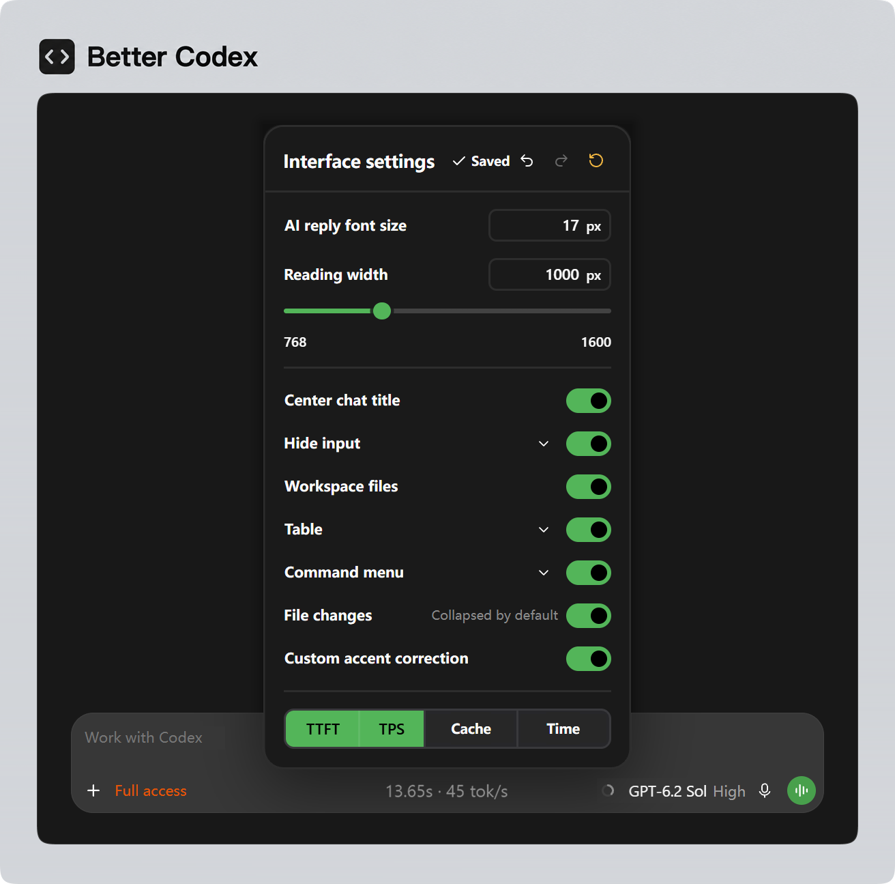
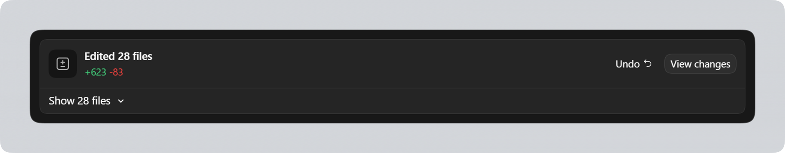

<h1 align="center">Better-Codex</h1>

  
  
  
  &nbsp;&nbsp;
  

Make Windows Codex conversations easier to read, with statistics beside the input box, adjustable reading width and compact file changes. The latest source adds a unified settings panel and sortable tables. Independent community project; not affiliated with OpenAI.

**Windows 11 x64 · Official Codex Store app · English / 简体中文 · Bundled portable runtimes**

Images use real Codex screenshots; table content and statistics are examples.

## Latest source

- **Four statistics:** time to first response (TTFT), output speed, cache percentage and sample age. Click the statistics to open settings; toggle individual fields or drag to reorder them.
- **Workspace files:** view the current workspace or worktree beside the chat, with live updates and files grouped by type, then sorted by name. Press Space to preview with PowerToys Peek or an [explicitly configured QuickLook](src/interface/README.md#工作区文件树), double-click to open a file, or click the project name to open its folder. Resize by dragging the edge; each project remembers whether the tree is open.
- **One settings panel:** adjust reading width from 768 to 1600 px and AI reply font size from 10 to 40 px. Leave the font field blank to follow Codex. You can also choose whether file lists start collapsed and toggle Custom accent correction. Changes save automatically, with undo, redo and restore defaults.
- **Auto-hide the input:** choose **Off**, **Minimize** or **Hide** in Interface settings. An empty input collapses when it loses focus in an existing chat, even while a task is running. Type directly from the conversation to open the input with IME support from the first key. After clicking a chat in the sidebar, you can also press Enter twice to open and focus its input, or click **Expand input** in Minimize mode. With **Hide after sending** enabled, successful sends also collapse the input if it still has focus. Blank new chats, unsent drafts and attachments stay visible.
- **Readable, sortable tables:** content determines column widths, with optional centering independent of reading width. Click a header to cycle through sorting directions and the original order; hold Ctrl to select multiple columns in priority order, or Alt to preset/reverse a direction. Choose Smart, Ascending or Descending as the first-click direction in settings. Sorting changes only the current visual order; copying retains the source order.
- **Reorder the slash-menu settings:** open **Interface settings → Command menu** for the two independent **Commands** and **Skills** sections. Drag their handles to reorder them. The Commands section keeps its button groups without subheadings.
- **Choose which Skills appear in the slash menu:** open **Interface settings → Command menu → Skills** to show or hide individual Skills. Health, Excel Live Control, Spreadsheets, Visualize, and Create Statusline are hidden by default. Skills remain enabled and available through the native `$` picker.
- **Prompt shortcuts in the slash menu:** reusable Markdown prompts from the first level of Codex Home's `prompts` folder appear below Skills in a three-column section. Activate one to insert its text at the current cursor without replacing your draft or sending it. `Ctrl+↑/↓` jumps between command groups, Skills and Prompt.
- **AI rename:** choose the sparkle item at the top of a local chat's sidebar menu, or use AI rename in the slash menu. Luna generates a concise Chinese title such as `feat：AI 重命名`, and Codex saves it in the background for the selected chat even if you switch chats. You can rename different chats in parallel; repeat requests for the same chat are ignored while it is running. Luna receives user messages and the first sentence of each assistant final answer. Your draft is untouched.
- **Local runtime history:** inspect recent startup, enhancement and recovery events with `tools/token-hud-local/Get-RuntimeHistory.ps1`. Records stay local and expire after five days; chat text is not recorded.

TTFT uses the first model response in the current turn. Speed uses magpie's latest valid native value for that turn when available; after a confirmed disconnection, subsequent turns use the local request average. That local average includes waiting and reasoning and excludes known tool execution. Missing timing stays unavailable, and a turn keeps one speed source. These statistics do not promise faster generation.

## Get started

1. Download `better-codex-v0.5.40-windows-x64-portable.zip` from [v0.5.40 Releases](https://github.com/MaxMiksa/better-codex/releases/tag/v0.5.40).
2. **Extract the entire ZIP** to a writable folder you plan to keep.
3. Run `BetterCodex.exe`. Click the statistics beneath the input box to adjust reading width. No Python/Node.js installation or first-launch dependency download is needed.

The shortcut runs the startup check when Codex isn't running. If Codex is already running, even in the background, clicking the taskbar icon brings it forward without starting another check. The startup check runs minimized and opens the full window only when something needs attention. Once checks pass, it stays minimized or returns to the taskbar if it opened automatically, then closes after 30 seconds. When missing enhancements or a completed Codex update are confirmed, a **15-second relaunch countdown** starts after all checks finish. Click to act immediately; **X / Esc cancels**. Recovery requests normal exit, never forces termination, and does not loop after failure. Cancel while you have work to preserve, then relaunch when convenient.

Run `Stop.cmd` at any time to stop enhancements and restore the native layout. Codex and chat history remain available. Use the combined entry again to restore enhancements.

## v0.5.40 features

| Task | What you get |
| --- | --- |
| Read statistics | Average output speed, input cache percentage and sample age for the latest completed response; each window binds to its own main chat |
| Adjust reading space | Click the statistics to set a width limit up to 1600px; main chats, side chats and subagents stay within their panels, and the input box keeps its width |
| Browse file changes | Multi-file lists start collapsed and can expand together; review/undo remain available, and a manually expanded card keeps its state |
| Use Custom colors | Readable user-message bubbles and send buttons with a custom accent; native presets remain intact |
| Name a chat with AI | The slash menu can summarize the current local chat with Luna into a short Chinese `feat：` / `bug：` style title and apply it through native rename; failures keep the original |
| Start and maintain | Combined shortcut, separate login-start switch, startup checks and sanitized reports; optional monitoring restores the enhancement entry after Codex updates |

Statistics follow the main input area's layout. Labels follow Codex's English/Simplified Chinese interface, falling back to the launch language when none is declared; other languages fall back to English. Chat mode keeps reading width and reply font size without these statistics. Documents and blank pages keep their native layout.

If a collector exits, only statistics become unavailable; reading width, file changes and appearance remain in place. Recovery is local and rate-limited, and data from an old collector is rejected.

## Common settings

Run these commands from the initialized extracted folder. Login startup and Codex update monitoring are off by default. Use the ordinary Codex launch entry.

| Task | PowerShell command |
| --- | --- |
| Enable login startup | `.\tools\token-hud-local\Set-LoginStartup.ps1 -Mode Enable` |
| Enable Codex update monitoring | `.\tools\token-hud-local\Set-UpdateRecovery.ps1 -Mode Enable` |
| Read either switch | Use `-Mode Status` with its script |
| Disable either switch | Use `-Mode Disable` with its script |
| Read-only launch check | `.\tools\token-hud-local\Start-ComposerHud.ps1 -CheckOnly` |

Keep a single login entry: turn off Codex's own login startup when enabling this project's entry. Update monitoring needs the enhancement host to keep running. A confirmed new version opens the same check before an optional relaunch; disabling monitoring does not cancel a countdown already open. It does not update Better-Codex itself. Recovery after a real future Codex upgrade still awaits natural-use acceptance.

Use `launchers/Codex.lnk` for taskbar pinning. Unpin the original Codex entry first, then pin the combined shortcut. Windows may require repinning after caching a path or app identity.

Upgrade, move or uninstall

If administrator launch was enabled in v0.4.1, first run `Set-AdministratorLaunch.ps1 -Mode Disable` from the old copy's `tools/token-hud-local/` folder before upgrading, moving or uninstalling. This is a legacy-version command.

Before upgrading or moving, disable any enabled login entry, then stop its enhancements with Stop.cmd. Extract the complete new package or move the whole folder, and run BetterCodex.exe from the new location. Path rebuilding preserves width preferences present in that folder. Repin if needed, then enable the switches you want. Shortcuts owned by another installation are not taken over.

To uninstall, disable login startup, run Stop.cmd, unpin the shortcut, and delete the extracted folder. Codex and chat history remain.

## Problems and limits

| Symptom | Action |
| --- | --- |
| Statistics are absent | Start with the read-only check. For the full check, run `tools/token-hud-local/Show-StartupCheck.ps1`; cancel its relaunch countdown while working |
| `restart-required` | The running instance lacks the display interface or required launch conditions. Exit normally when convenient, then use the combined entry |
| `hud-preparation-failed` | Check for missing files. Stop this copy's enhancements and extract the complete ZIP to a new folder; do not run inside the ZIP |
| A dash or temporarily hidden statistics | Usage/timing is unavailable, chat identity is uncertain, data is stale, or the layout is incompatible; this is not zero speed, and another chat's data is never substituted |

Speed is the **completed response average** from a known request boundary to the usage record, including waiting/reasoning and excluding known tool execution. Output usage includes reasoning and tool-call tokens. It is not a live per-token rate or a pure model decoding benchmark, and does not promise faster generation. Cloud-only chats cannot supply local statistics.

Checks send no model message, do not verify model authentication, and do not control VPN software. Uncertain sandbox or proxy conditions stay unconfirmed.

Codex UI updates may need adaptation. All app versions, window layouts and display scales have not been fully validated. The launcher is unsigned, so Windows may show a publisher prompt.

## Privacy

Model requests keep Codex's existing connection. Better-Codex adds no model proxy and needs no extra API key. Portable packaging does not make model requests offline. AI rename is the one enhancement that sends conversation-derived text to a model, and only after you choose it; see [Privacy](docs/PRIVACY.md). Startup checks make a small credential-free HTTPS request through the detected network path.

Local state can contain chat identifiers, titles, paths and usage. **Do not upload .runtime/, authentication files or raw Codex logs.** Report the version, symptom and sanitized startup report instead. Do not expose or forward the local display interface to the internet. See [Privacy](docs/PRIVACY.md).

## Development and credits

For the latest interface shown above, clone or download the **main branch** of this repository. For a fixed version, use `better-codex-v0.5.40-source.zip`. Current source installation needs Python 3.11+, Node.js 22.15.0 or later; run `powershell -NoProfile -ExecutionPolicy Bypass -File .\Install.ps1`. No npm package or Playwright is needed to run the enhancements. Optional `-Language en` / `-Language zh-CN` selects setup messages. Follow the [development guide](docs/DEVELOPMENT.md) bundled with your chosen source version.

The local collector is reused from [codex-token-hud](https://github.com/drkang7/codex-token-hud). Thank you to [codex-lite-hud](https://github.com/flitfancy/codex-lite-hud), [codex-speed-hud](https://github.com/Creative-developer-single/codex-speed-hud), and [openai/codex](https://github.com/openai/codex). See [Third-party notices](THIRD_PARTY_NOTICES.md) for reuse scope, versions and licenses.

Issues and Pull Requests are welcome. Contact Zheyuan (Max) Kong: kongzheyuan@outlook.com · zheyuank@andrew.cmu.edu.
