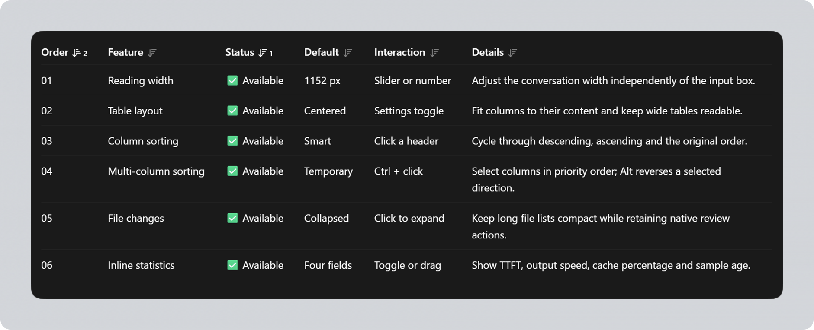
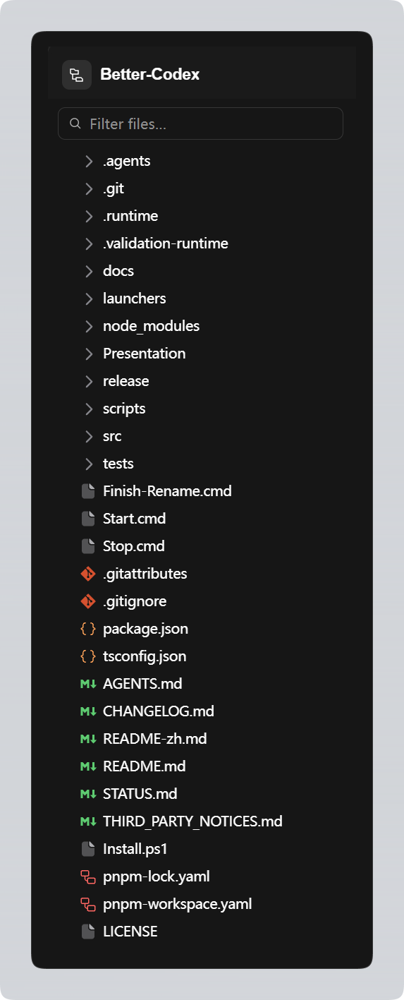
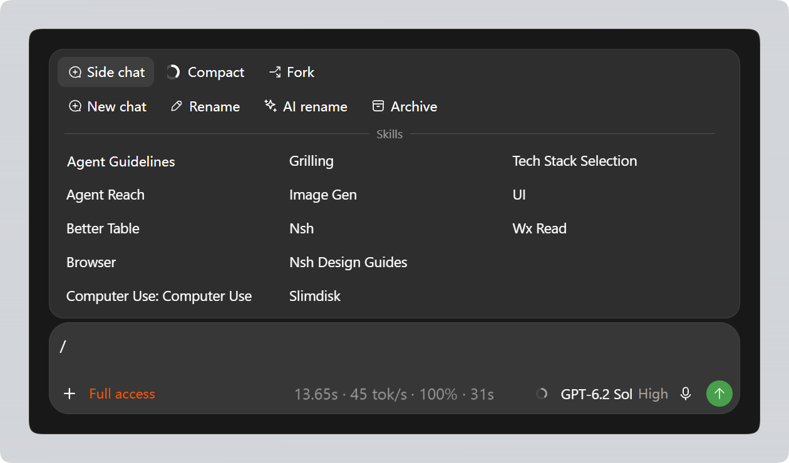
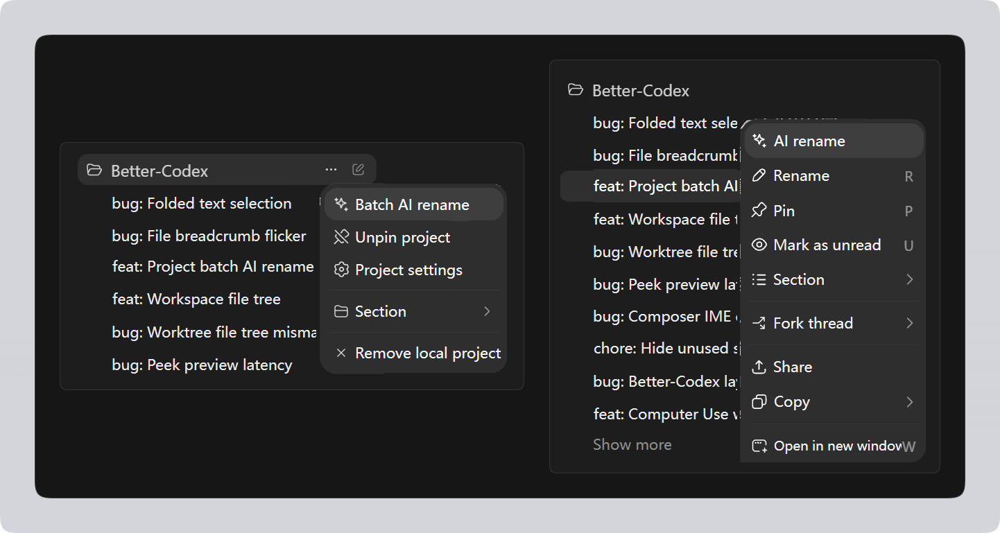

<h1 align="center">Better-Codex</h1>

  
  
  
  &nbsp;&nbsp;
  

A reversible UI enhancement and startup layer for the official Windows Codex desktop app — bringing a unified settings panel, inline statistics, workspace file tree, enhanced slash command menu, AI chat renaming, auto-hiding input, sortable tables, and compact file changes. Independent community project; not affiliated with OpenAI.

**Windows 11 x64 · Official Codex Store app · English / 简体中文 · Single bundled Node.js 24 runtime (~37 MB portable)**

All visuals are based on real Codex screenshots (with distractions masked out); statistics values and sample tables are for demonstration.

## Features

### Reading, layout & tables

- **Unified settings panel:** click the statistics bar beneath the input box to open **Interface settings**. Adjust reading width (`768–1600 px`) and AI reply font size (`10–40 px`; leave blank to follow Codex), center chat titles, toggle individual features, and rely on automatic saving, undo/redo, restore defaults, and multi-window sync. Main chats, side chats, and subagents stay within their panels while the input box keeps its native width; native file-page breadcrumbs stay flicker-free.
- **Auto-hide input:** choose **Off**, **Minimize**, or **Hide** in Interface settings. An empty input collapses on blur in existing chats (even while a task is running) or on `Esc`, while keeping the bottom file-change pill visible. Type directly from the conversation to open the input with IME composition from the first key, press Enter twice after clicking a chat in the sidebar, or click **Expand input** in Minimize mode. Text selection never steals focus. With **Hide after sending** enabled, successful sends also collapse the input; blank new chats, unsent drafts, and attachments always stay visible.
- **Readable, sortable tables:** content determines column widths, with optional centering independent of reading width. Click a header to cycle sorting directions and the original order; hold `Ctrl` to select multiple columns in priority order, or `Alt` to preset/reverse a direction. Pick **Smart**, **Ascending**, or **Descending** as the first-click default. Sorting changes only visual order; copying preserves the original Markdown order.
- **Compact file changes:** multi-file change lists start collapsed by default while keeping native **Undo** and **View changes** actions intact; manually expanded cards keep their state.

### Workspace files & slash command menu

- **Workspace file tree:** view the current chat's workspace or worktree beside the conversation with live directory updates, instant filtering, type-grouped sorting, drag-to-resize rail, and per-project open state — coexisting cleanly with Codex's native right panel. Click the project title to open its folder, double-click to open a file (scripts and executables reveal rather than execute), right-click to reveal in Explorer, or press `Space` to preview with the optional standalone [Preview](https://github.com/MaxMiksa/preview) companion app, [QuickLook, or PowerToys Peek](src/features/workspace-tree/README.md).
- **Enhanced `/` slash menu:** top-level commands appear in compact horizontal button groups, followed by a three-column **Skills** section and three-column **Prompt** shortcuts loaded from the first level of Codex Home's `prompts` folder. Open **Interface settings → Command menu** to reorder sections or commands and show/hide individual Skills (Health, Excel Live Control, Spreadsheets, Visualize, and Create Statusline are hidden by default while remaining enabled in the native `$` picker). Selecting a Prompt inserts its text at the cursor without replacing your draft or sending it; `Ctrl+↑/↓` jumps between sections.

### AI rename

- **Single & batch AI rename:** rename any local chat from its sidebar context menu or the `/` menu, or choose **Batch AI rename** from a project's `…` menu. Batch rename targets active local and worktree chats in that sidebar group whose titles do not already contain `：`, running up to 3 concurrent requests and re-checking before saving. Program logic selects the chats while Luna generates structured titles such as `feat：AI 重命名`; Codex saves them natively in the background without touching your draft.

### Inline statistics, appearance & observability

- **Four inline statistics:** time to first token (**TTFT**), output speed (**TPS**), input cache percentage, and sample age beside the main input bar — each window bound to its own main chat. Toggle individual fields or drag to reorder them in Interface settings; narrow bars automatically avoid buttons and quota rings. Labels follow Codex's English/Simplified Chinese interface. Chat mode keeps reading width and AI reply font size without statistics; documents and blank pages stay native.
- **Custom accent correction:** computes WCAG-readable foreground colors for user bubbles and primary send buttons when using Codex's Custom accent theme; native presets remain untouched.
- **Local runtime history:** inspect recent startup, enhancement, and recovery events from a 5-day local SQLite log via `src/platform/observability/Get-RuntimeHistory.ps1` (or `pnpm run history`). Records stay local and never store chat text.

> **About statistics:** TTFT measures the first model response in the current turn. Speed prefers magpie's latest valid native measurement for that turn when available; after a confirmed disconnection, subsequent turns fall back to the local completed-response average (from a known request boundary to usage completion, including waiting and reasoning and excluding known tool execution; output usage includes reasoning and tool-call tokens). Missing timing stays unavailable rather than showing zero, and a turn never mixes speed sources. Cloud-only chats cannot provide local statistics, and statistics do not promise faster generation. If a collector exits, only statistics pause while reading width, workspace tree, tables, file changes, and appearance stay active.

## Get started

1. Download `better-codex-v1.0.0-windows-x64-portable.zip` from [v1.0.0 Releases](https://github.com/MaxMiksa/better-codex/releases/tag/v1.0.0).
2. **Extract the entire ZIP** to a writable folder you plan to keep.
3. Run `BetterCodex.exe`. Click the statistics bar beneath the input box to open Interface settings. No separate Node.js, Python, or Playwright installation is needed, and first launch downloads no dependencies.

When Codex is not running, the shortcut runs a minimized startup check and opens the full window only if something needs attention; once checks pass, it stays minimized (or retracts automatically) and closes after 30 seconds. If Codex is already running, clicking the taskbar icon simply brings it forward without starting another check. When missing enhancements or a completed Codex update are confirmed, a **15-second relaunch countdown** starts after all checks finish — click to act immediately or press **X / Esc** to cancel while preserving active work. Recovery requests normal exit only, never forces termination, and does not loop on failure.

Run `Stop.cmd` at any time to stop enhancements and restore the native Codex layout without closing Codex or touching chat history. Launch `BetterCodex.exe` (or `Start.cmd`) again to re-enable enhancements.

## Common settings

Run these commands from the initialized folder. Login startup and Codex update monitoring are off by default. Use the ordinary Codex launch entry.

| Task | PowerShell command |
| --- | --- |
| Enable login startup | `.\src\lifecycle\installation\Set-LoginStartup.ps1 -Mode Enable` |
| Enable Codex update monitoring | `.\src\lifecycle\recovery\Set-UpdateRecovery.ps1 -Mode Enable` |
| Read either switch | Use `-Mode Status` with its script |
| Disable either switch | Use `-Mode Disable` with its script |
| Read-only launch check | `.\src\app\Start-ComposerHud.ps1 -CheckOnly` |
| Inspect 5-day runtime history | `.\src\platform\observability\Get-RuntimeHistory.ps1` |

Keep a single login entry: disable Codex's own login startup when enabling Better-Codex's entry. Update monitoring requires the enhancement host to stay running; a confirmed Codex update opens the same check and cancelable relaunch countdown (it does not update Better-Codex itself, and recovery after a future real Codex upgrade still awaits natural-use acceptance).

Use `launchers/Codex.lnk` for taskbar pinning — unpin the original Codex icon first, then pin the combined shortcut.

Upgrade, move or uninstall

- **Upgrading from v0.5.x to v1.0.0:** see [UPGRADE-v1.md](docs/UPGRADE-v1.md). Existing preferences and shortcuts owned by this copy migrate automatically and losslessly to `.runtime/settings.json` on first run.
- **General upgrade or folder move:** disable any enabled login startup, run `Stop.cmd`, extract the new package or move the entire folder, and run `BetterCodex.exe` from the new location (repining `launchers/Codex.lnk` if needed). Shortcuts owned by another installation are not taken over. *(If migrating from legacy v0.4.1 with administrator launch enabled, first disable it via `tools/token-hud-local/Set-AdministratorLaunch.ps1 -Mode Disable` in the old copy.)*
- **Uninstall:** disable login startup, run `Stop.cmd`, unpin the shortcut, and delete the folder. Codex and your chat history remain intact.

## Problems and limits

| Symptom | Action |
| --- | --- |
| Statistics are absent | Run the read-only check first. For full diagnostics, run `src/lifecycle/diagnostics/Show-StartupCheck.ps1` and cancel the relaunch countdown if you are actively working |
| `restart-required` | The running Codex instance lacks the display interface or required launch conditions; exit Codex normally when convenient and reopen via the combined shortcut |
| `hud-preparation-failed` | Check for missing files; stop enhancements and extract the complete ZIP to a fresh folder (do not run inside the ZIP) |
| A dash (`-`) or hidden statistics | Timing/usage is unavailable, chat identity is uncertain, data is stale, or the layout is incompatible; this is not zero speed, and another chat's data is never substituted |

Startup checks send no model message, do not verify model authentication, and do not control VPN software. Future Codex UI updates may require adaptation; not every app version, window layout, or display scale has been exhaustively validated. The portable launcher is unsigned, so Windows may show a publisher prompt on first run.

## Privacy

Model traffic stays on Codex's native connection — Better-Codex adds no model proxy and needs no extra API key (portable packaging does not make models offline). **AI rename** is the only feature that sends conversation-derived text to a model, and only after you explicitly trigger it; see [Privacy](docs/PRIVACY.md). Startup checks send a small credential-free HTTPS HEAD probe along the detected network path.

Local state under `.runtime/` can contain chat identifiers, titles, paths, and usage. **Never upload `.runtime/`, authentication files, or raw Codex logs.** Share the version, symptom, and sanitized startup check report instead, and never expose or forward the local display port externally. See [Privacy](docs/PRIVACY.md).

## Development and credits

For a fixed source archive, download `better-codex-v1.0.0-source.zip` from [v1.0.0 Releases](https://github.com/MaxMiksa/better-codex/releases/tag/v1.0.0), or clone the `main` branch. Source installation requires **Node.js 24.11.1+** (24.x line) — run `powershell -NoProfile -ExecutionPolicy Bypass -File .\Install.ps1` (optional `-Language en` / `-Language zh-CN`). Production runtime requires zero npm packages, Python, or Playwright. See [DEVELOPMENT.md](docs/DEVELOPMENT.md) and [CHANGELOG.md](CHANGELOG.md).

The local statistics collector is reused from [codex-token-hud](https://github.com/drkang7/codex-token-hud). Thank you to [codex-lite-hud](https://github.com/flitfancy/codex-lite-hud), [codex-speed-hud](https://github.com/Creative-developer-single/codex-speed-hud), and [openai/codex](https://github.com/openai/codex). See [Third-party notices](THIRD_PARTY_NOTICES.md) for reuse scope, versions, and licenses.

Issues and Pull Requests are welcome. Contact Zheyuan (Max) Kong: kongzheyuan@outlook.com · zheyuank@andrew.cmu.edu.
